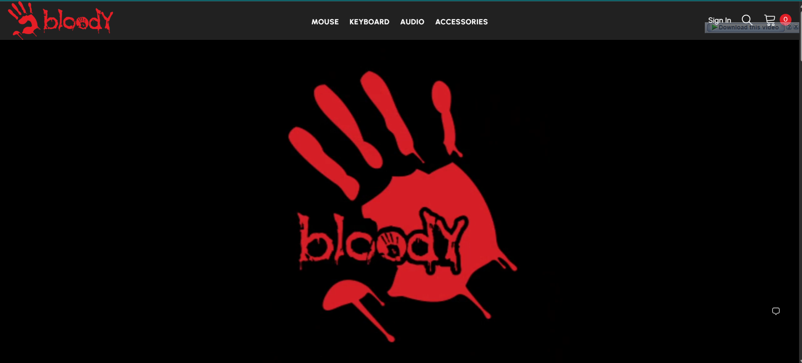
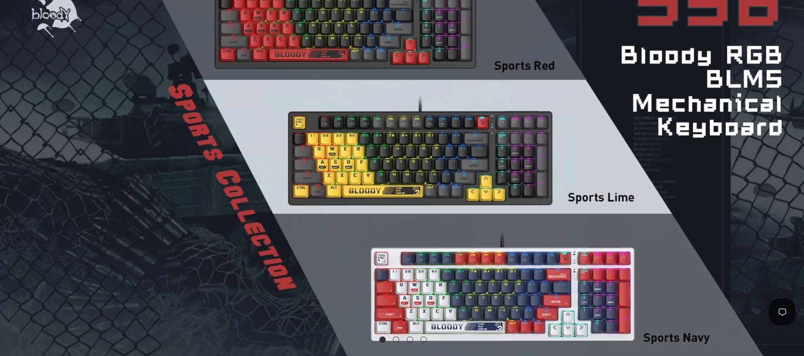
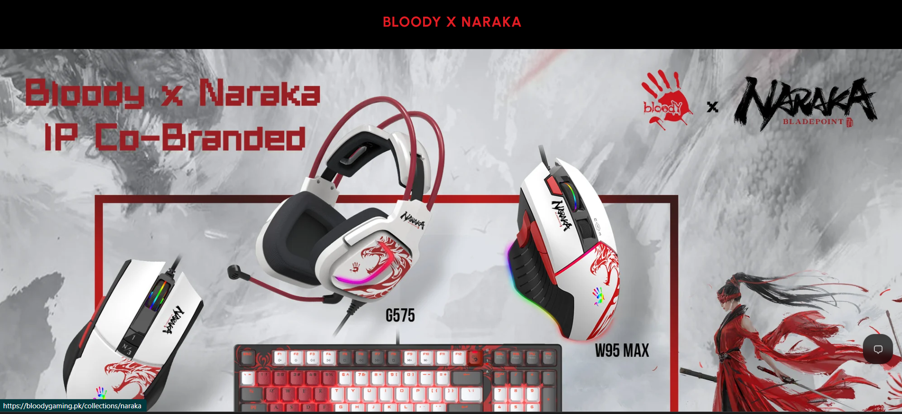
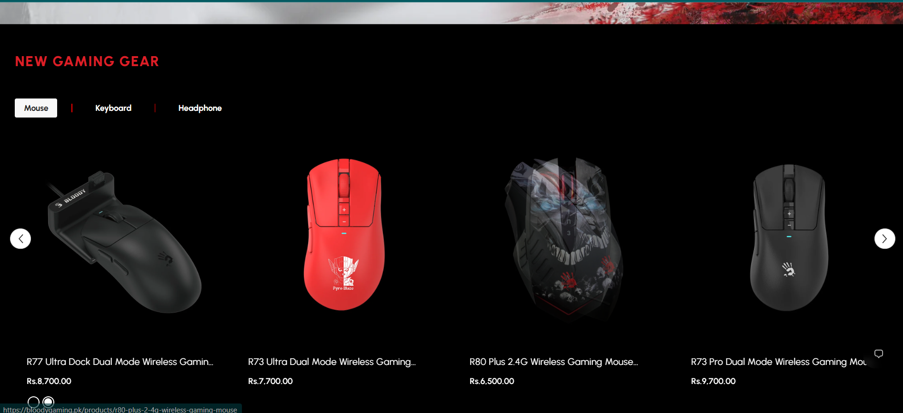
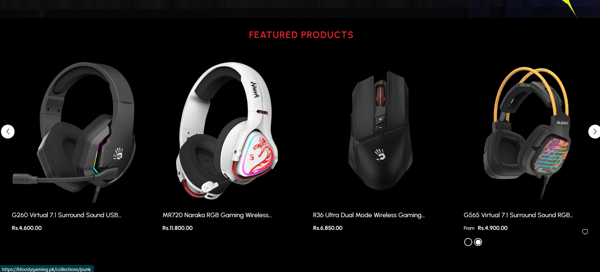
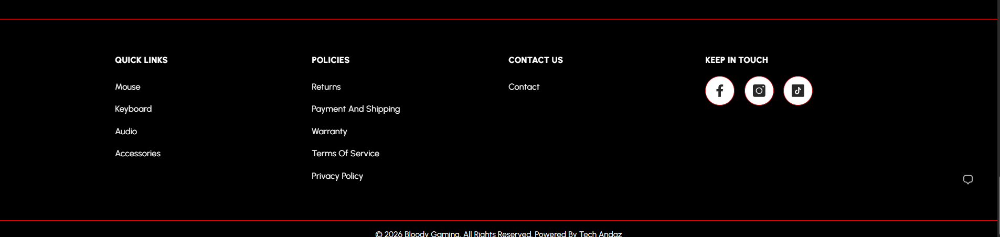

Author: Hamza (FA24-BCS-040), BS Computer Science, COMSATS University Islamabad, Lahore Campus

Site Name: Bloody Gaming Store
Site URL: https://bloodygaming.pk/
A static, responsive e-commerce front end modeled on the Bloody Gaming Store. It has a home page that lists gaming gear and a product detail page, built with HTML, CSS and Bootstrap.

